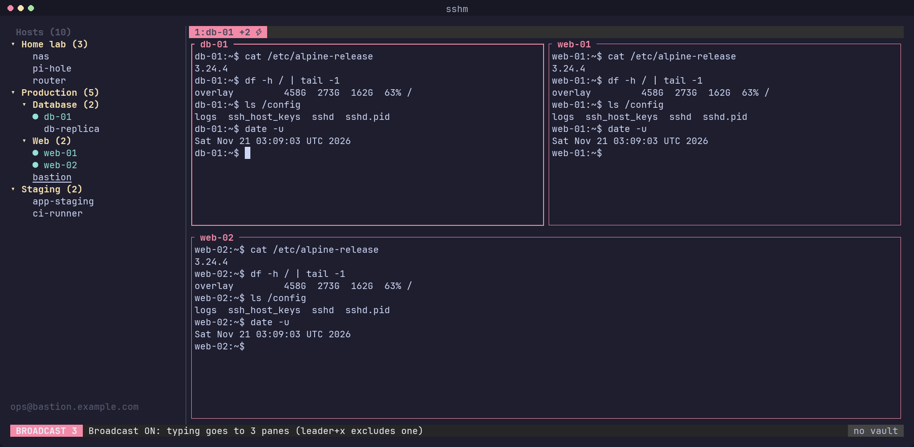

# sshm

An SSH session manager that runs in your terminal, in the spirit of MobaXterm or Ásbrú.



## Features

- **Host book** with folders, tags and fuzzy search, kept in a plain `hosts.toml`.
- **Saved passwords** from the desktop keyring, an encrypted vault (age), Bitwarden, 1Password
  or any command. They answer ssh's password prompt on connect, and `sudo` prompts later on.
- **Plain `ssh` underneath**: `~/.ssh/config`, ProxyJump, ssh-agent and FIDO keys work as usual.
- **Many sessions at once**: tabs, an automatic grid of panes, and broadcast to type into all of
  them.
- **Built-in SFTP**: a two-panel browser with an upload/download queue. It reuses the session's
  connection, so you don't log in twice.
- **Import / export**: `~/.ssh/config`, MobaXterm, Ásbrú, Remmina, JSON, CSV, or an encrypted
  bundle that carries the passwords.
- **Vim keys everywhere**, mouse support and seven color themes.

It runs in any terminal emulator on any Linux distribution.

| SFTP | Editing a host |
|---|---|
|  |  |

## Install

```sh
git clone https://github.com/ramirocabral/sshm && cd sshm
./install.sh            # builds and installs ~/.local/bin/sshm
```

You need Rust 1.89+ to build it and OpenSSH 8.4+ to run it. `install.sh` never installs
packages: it tells you what is missing and the command for your distro. Optional extras are
`secret-tool` (keyring), `wl-copy`/`xclip`/`xsel` (clipboard) and `bw`/`rbw`/`op`.

## Usage

```sh
sshm import ssh-config ~/.ssh/config   # optional: bring your hosts in
sshm
```

In the host list, `n` creates a host and `Enter` connects. `Space` marks several hosts, and
then `Enter` opens them all in a grid. `s` opens SFTP and `/` searches.

Inside a session, every key goes to the remote side except the leader key, `Ctrl+Space`:

| Leader + | |
|---|---|
| `Tab` | focus the host list |
| `h` `j` `k` `l` | move between panes |
| `b` | broadcast to every pane in the tab |
| `p` | type the saved password into a `sudo`/`su` prompt |
| `s` | SFTP to this host |
| `[` | copy mode (vi keys) |
| `:` | command palette |
| `?` | every key binding |

Import and export also work from the command line:

```sh
sshm import mobaxterm MobaXterm.ini        # also asbru, remmina, json, csv, bundle
sshm export --format bundle -o backup.age  # hosts + passwords, encrypted
```

## Configuration

`~/.config/sshm/config.toml`. Run `sshm config` for every option and where the files live.

```toml
leader = "ctrl+space"   # e.g. "ctrl+a", "f12"
theme = "default"       # light, nord, gruvbox, dracula, catppuccin, solarized
vault_timeout = 0       # seconds idle before the vault locks again (0 = never)
scrollback = 10000
```

Each host chooses where its password comes from: `keyring`, `vault`, `none`, `bw:<item>`,
`rbw:<item>`, `op://vault/item/field` or `cmd:<command>`. Hosts are kept in
`~/.local/share/sshm/hosts.toml`, without secrets. The vault is `vault.age` in the same folder,
a standard age file.
