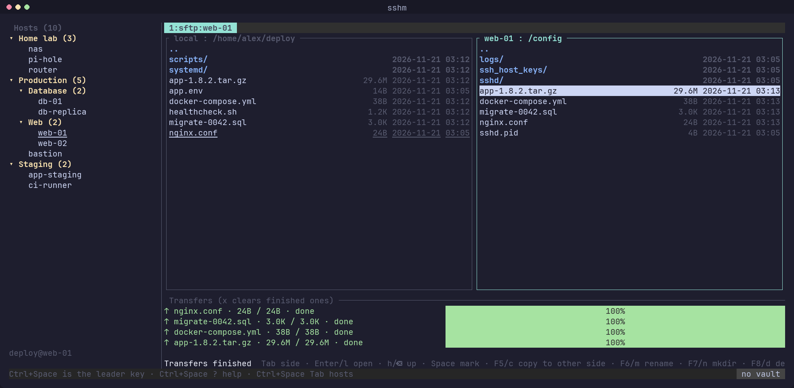
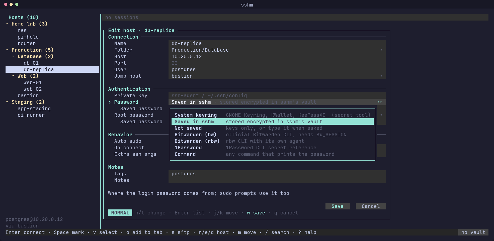

# sshm

An SSH session manager that runs in your terminal, in the spirit of MobaXterm or Ásbrú.


## Features

- **Host book** with folders, tags and fuzzy search.
- **Saved passwords** from the desktop keyring, an encrypted vault (age), Bitwarden, 1Password
  or any command
- **Plain `ssh` underneath**: `~/.ssh/config`, ProxyJump, ssh-agent and FIDO keys work as usual.
- **Many sessions at once**: tabs, an automatic grid of panes, and broadcast to type into all of
  them.
- **Built-in SFTP**: a two-panel browser with an upload/download queue.
- **Import / export**: `~/.ssh/config`, MobaXterm, Ásbrú, Remmina, JSON, CSV, or an encrypted
  bundle that carries the passwords.
- **Vim keys everywhere**, mouse support and seven color themes.

| SFTP | Editing a host |
|---|---|
|  |  |

## Install

Install dependencies (Rust 1.89+ to build, OpenSSH 8.4+ to run):

```sh
# Arch
sudo pacman -S --needed rust gcc openssh git

# Debian, Ubuntu
sudo apt install build-essential openssh-client git curl
curl --proto '=https' --tlsv1.2 -sSf https://sh.rustup.rs | sh

# Fedora, RHEL, AlmaLinux, Rocky
sudo dnf install gcc openssh-clients git curl
curl --proto '=https' --tlsv1.2 -sSf https://sh.rustup.rs | sh
```

Optional: `secret-tool` to keep passwords in the desktop keyring, and a clipboard tool
(`wl-clipboard` on Wayland, `xclip` on X11). The `bw`, `rbw` and `op` CLIs are only needed by
hosts that take their password from Bitwarden or 1Password.

```sh
sudo pacman -S --needed libsecret wl-clipboard    # Arch
sudo apt install libsecret-tools wl-clipboard     # Debian, Ubuntu
sudo dnf install libsecret wl-clipboard           # Fedora (on RHEL, wl-clipboard is in EPEL)
```

Build and install to `~/.local/bin` (`PREFIX=/some/dir` installs somewhere else):

```sh
git clone https://github.com/ramirocabral/sshm && cd sshm
./install.sh
```

Uninstall (your hosts and vault are kept):

```sh
./install.sh --uninstall
```

## Usage

```sh
sshm import ssh-config ~/.ssh/config   # optional: bring your hosts in
sshm
```

In the host list, `n` creates a host and `Enter` connects. `Space` marks several hosts, and
then `Enter` opens them all in a grid. `s` opens SFTP and `/` searches.

Inside a session, every key goes to the remote side except the leader key, `Ctrl+Space`:

| Leader + | |
|---|---|
| `Tab` | focus the host list |
| `h` `j` `k` `l` | move between panes |
| `b` | broadcast to every pane in the tab |
| `p` | type the saved password into a `sudo`/`su` prompt |
| `s` | SFTP to this host |
| `[` | copy mode (vi keys) |
| `:` | command palette |
| `?` | every key binding |

Import and export also work from the command line:

```sh
sshm import mobaxterm MobaXterm.ini        # also asbru, remmina, json, csv, bundle
sshm export --format bundle -o backup.age  # hosts + passwords, encrypted
```

## Configuration

`~/.config/sshm/config.toml`. Run `sshm config` for every option and where the files live.

```toml
leader = "ctrl+space"   # e.g. "ctrl+a", "f12"
theme = "default"       # light, nord, gruvbox, dracula, catppuccin, solarized
vault_timeout = 0       # seconds idle before the vault locks again (0 = never)
scrollback = 10000
```
